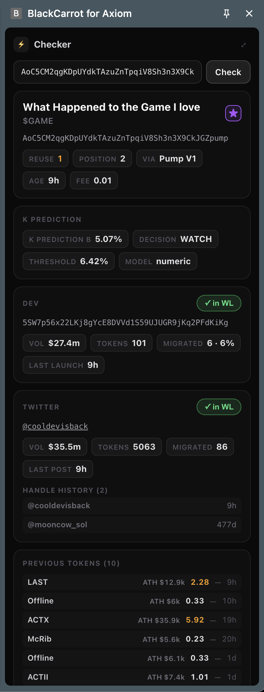
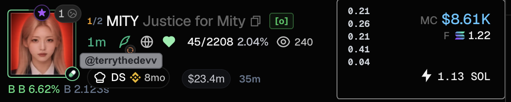
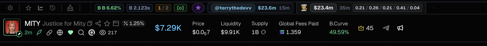

# BlackCarrot for Axiom

**Версия 0.2.69 · Chrome · Axiom / Solana**

Данные qualified pair и fast ai prediction прямо в Axiom Pulse, на странице токена и в отдельном Checker.

Исходный код браузерного расширения открыт для просмотра. Для серверных данных нужен отдельный действующий ключ; сервер, база и модель в этот репозиторий не входят. За тестовым доступом в тг — [@Coun1er](https://t.me/Coun1er).

## Возможности

- Qualified pair - помечает трастовые связки дев-адреса и Twitter-хендла.
- Ai prediction: процент и решение `SKIP`, `WATCH` или `BUY_CANDIDATE`.
- Накопленный volume по dev-адресу и/или Twitter.
- Время предыдущего запуска дева и предыдущей публикации Twitter с токеном.
- Fee прошлых токенов вертикальным списком внутри Quick Buy.
- Счётчик повторного использования имени/тикера и позиция токена в публикации.
- WL по dev-адресу, текущему Twitter-хендлу и истории хендлов; отдельные звуки совпадений.
- Отдельные метки для dev volume и Twitter volume: у каждой свой порог, цвет и переключатель показа. Метки видны на картинке в Pulse, на странице токена и в Checker.
- Независимые автооткрытие и автопокупка по проценту либо минимальному статусу ai prediction. Быстрые OPEN/BUY-переключатели в Pulse.
- Настраиваемое автоозвучивание названия токена и рейтинга ai prediction.
- Checker по адресу токена: стартовые данные, прогноз, dev/Twitter-статистика, история хендлов, прошлые токены с ATH и fee, добавление в WL.
- Сворачиваемая панель дополнительных данных на странице токена.

## Как выглядит

### Checker

### Карточка в Pulse

### Страница токена

## Настройки

Укажите адрес сервера в поле над ключом (IP, IP:порт или HTTP/HTTPS-адрес), вставьте Access key и нажмите **Connect**. При первом подключении разрешите Chrome доступ к указанному серверу. Кнопка **Checker** открывает проверку по адресу токена.

| Блок | Что настраивается |
| --- | --- |
| Whitelists | Dev-адреса и Twitter-хендлы по одному в строке; хендлы без @ |
| WL match sounds | Отдельные звуки для dev, Twitter и совместного совпадения |
| K prediction · Open token | Автооткрытие, минимальный процент или статус |
| K prediction · Auto-buy | Автопокупка, минимальный процент или статус, произношение после отправки клика покупки |
| K prediction · Voice checker | Озвучивание названия и процента со своим условием |
| Position / reuse | Пороги подсветки значений |
| Previous-token fees | Показ внутри Quick Buy, количество fee, порог и цвет выделения |
| Data display | Независимый показ dev/Twitter volume, времени предыдущих запусков и задержки update_b |
| Volume badges | Независимые пороги, цвета и переключатели звёзд dev/Twitter volume; показ qualified pair |

Статус задаёт минимальный уровень: **SKIP → WATCH → BUY_CANDIDATE**. Например, WATCH захватывает и WATCH, и BUY_CANDIDATE. Если одновременно подходят условия OPEN и BUY, приоритет у BUY. Изменения применяются после **Save settings**.

Данные по WL хранятся локально. В интерфейсе метки означают: `[DWL]` — dev, `[TWL]` — текущий Twitter, `[TWL1]` и далее — исторический хендл, `[o]` — dev и Twitter вместе.

## Установка

1. Скачайте ZIP репозитория через **Code → Download ZIP** и распакуйте его.
2. Откройте `chrome://extensions` и включите **Режим разработчика**.
3. Нажмите **Загрузить распакованное расширение** и выберите папку с `manifest.json`.
4. Обновите вкладку Axiom. Настройки открываются нажатием на значок расширения в Chrome.

Сборка и установка npm-зависимостей не требуются. После обновления файлов перезагрузите расширение на странице `chrome://extensions` и обновите Axiom.

## Работа с данными

Ключ доступа, настройки, списки и кеши сохраняются в хранилище расширения.

Автопокупка использует текущие сумму, кошелёк и пресет Axiom Quick Buy. Отправленный клик не подтверждает исполнение транзакции.
